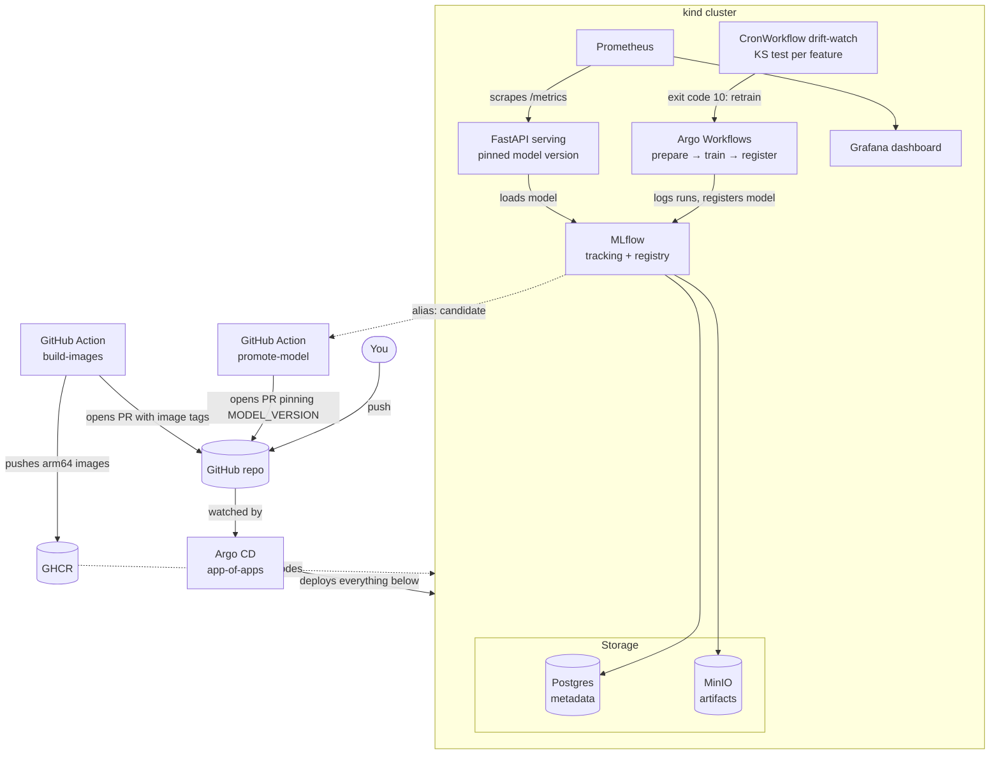

# MLOps platform lab

A complete, local ML platform on a [kind](https://kind.sigs.k8s.io/) cluster, run end to end with GitOps:
data → training → model registry → serving → monitoring → drift detection → retraining.
Everything running in the cluster is deployed from this repository by Argo CD.

## What it is

A model (a scikit-learn classifier on the Breast Cancer dataset) is the payload; the platform around it is the point.

- **Everything is declared in git.** Argo CD watches `gitops/apps/` (app-of-apps) and deploys the whole stack.
- **Training is a pipeline.** Argo Workflows runs `prepare → train → register` as containers; MLflow tracks runs and holds the model registry (metadata in Postgres, artifacts in MinIO).
- **Promotion is a pull request.** The registry marks the best model as `candidate`; a GitHub Action opens a PR that pins that version in the serving Deployment. Merging it is the deployment, reverting it is the rollback.
- **Serving is observable.** A FastAPI service exposes `/predict`, `/healthz` and Prometheus metrics; a Grafana dashboard shows version, request rate, p95 latency and errors.
- **Drift triggers retraining.** A scheduled workflow runs a per-feature Kolmogorov–Smirnov test against the training data and starts retraining when it finds drift.

## Architecture



## Stack

| Component | Role |
|---|---|
| kind | local Kubernetes |
| Argo CD | GitOps controller, app-of-apps |
| Argo Workflows | runs the training and drift pipelines |
| MLflow | experiment tracking and model registry |
| PostgreSQL / MinIO | MLflow metadata store / S3-compatible artifact store |
| FastAPI | model serving |
| kube-prometheus-stack | Prometheus, Grafana, ServiceMonitor |
| GitHub Actions + GHCR | image builds and the model promotion PR |

## Repository layout

| Path | Contents |
|---|---|
| `cluster/` | kind config and the root Argo CD Application |
| `gitops/apps/` | one Argo CD Application per component |
| `gitops/manifests/` | our own manifests: MLflow, serving, workflow templates, dashboard |
| `ml/pipeline.py` | pipeline steps: `prepare`, `train`, `register`, `drift` |
| `ml/serve.py` | the serving API |
| `images/` | Dockerfiles for the MLflow, training and serving images |
| `workflows/` | one-off runs of the training and drift workflows |
| `.github/workflows/` | `build-images` (images to GHCR, PR with tags) and `promote-model` (model version PR) |
| `terraform/` | the same platform on AWS EKS, as code only (see [terraform/README.md](terraform/README.md)) |

## How to run it

Requirements: Docker with at least 8 GB of memory (the platform uses about 5 GB), `kind`, `kubectl`, `helm`.
The images are built for arm64 only, so use Apple Silicon or another arm64 machine. The first start is slow:
the MLflow image alone took about three minutes to pull.

0. **Prepare your fork.** Argo CD can only sync a repo it can read, so edit two things and push before you start:
   - `repoURL` in `cluster/root-app.yaml` and `gitops/apps/{mlflow,workflows,serving,dashboards}.yaml`: point them at your fork.
   - `MODEL_VERSION` in `gitops/manifests/serving/deployment.yaml`: this repo pins `"6"`, which exists only in the author's
     registry. On a fresh cluster the first trained model is version 1, so set it to `"1"`.

1. **Create the cluster.** The images are public on GHCR and the nodes pull them, so there is nothing to build:

   ```bash
   kind create cluster --name mlops-lab --config cluster/kind-config.yaml
   ```

2. **Install Argo CD and hand it the repo:**

   ```bash
   helm repo add argo https://argoproj.github.io/argo-helm
   helm install argocd argo/argo-cd -n argocd --create-namespace --version 10.15.0
   kubectl apply -f cluster/root-app.yaml
   kubectl -n argocd get applications
   ```

   Wait until every application is `Synced` and `Healthy` except `serving`. It is expected to stay `Progressing` or
   `Degraded`: it crash-loops until the model it pins exists.

3. **Train the first model:**

   ```bash
   kubectl -n mlops create -f workflows/run-training.yaml
   kubectl -n mlops get workflows
   ```

   The first run registers version 1 and marks it `candidate`. `serving` recovers by itself on its next restart, because
   a failed model load aborts startup and Kubernetes retries. To skip the restart back-off:

   ```bash
   kubectl -n mlops rollout restart deploy/serving
   ```

4. **Try it:**

   ```bash
   kubectl -n mlops port-forward svc/serving 8000:8000
   curl -s localhost:8000/healthz
   curl -s localhost:8000/predict -H 'content-type: application/json' \
     -d "$(python3 -c 'import json; print(json.dumps({"features": [0.0] * 30}))')"
   ```

5. **Look at it:**

   ```bash
   kubectl -n monitoring port-forward svc/kube-prometheus-stack-grafana 3000:80
   ```

   Open http://localhost:3000 (`admin` / `admin123`) and the **Model serving** dashboard.

6. **Trigger drift and retraining:**

   ```bash
   kubectl -n mlops create -f workflows/run-drift-check.yaml
   ```

   This simulates a shift of one standard deviation on five features. The check exits with code 10, and the workflow
   starts retraining. A crash in the check exits with code 1 and fails the workflow instead, so a broken check is never
   mistaken for drift.

7. **Promote a newer model (optional).** The workflow opens a pull request, so the fork must allow Actions to create them
   (one time, or Settings → Actions → General → Workflow permissions):

   ```bash
   gh api -X PUT repos/<you>/<fork>/actions/permissions/workflow \
     -f default_workflow_permissions=write -F can_approve_pull_request_reviews=true
   gh workflow run promote-model -f version=2
   ```

   Review the one-line PR it opens and merge it; Argo CD rolls out the new version.

## Design decisions

- **Git holds the deployed model version.** Serving does not follow a registry alias; a PR changes `MODEL_VERSION`.
  A version that fails to load keeps the pod from becoming Ready, so the previous version keeps serving.
- **`register` only nominates.** It sets the `candidate` alias when accuracy is strictly better; it never deploys.
- **Drift test.** Kolmogorov–Smirnov per feature with a Bonferroni-corrected threshold (`0.05 / 30`), because 30 uncorrected
  tests flag about one or two features by chance on clean data.
- **Images ship through a PR too.** `build-images` builds the three images on a native arm64 runner and tags them with the
  commit SHA, so a tag never changes under a running Deployment. It then opens a PR that points the manifests at them;
  merging it is the rollout. It runs on changes to `images/` and `ml/`, or by hand: `gh workflow run build-images`.

## Known limitations

- "Live" data for the drift check is simulated: held-out rows of the same dataset plus a controlled shift. The serving API
  does not log requests, so there is no real production sample yet.
- Retraining on unchanged data reproduces the same model; the drift loop demonstrates the mechanism, not an improvement.
- Images are arm64 only, and `build-images` pushes to the GHCR of whoever owns the repo, so a fork must run it once and
  merge its PR before the manifests point at the fork's images.
- `promote-model` is started by hand. GitHub-hosted runners cannot reach an MLflow running on a laptop.
- Credentials (`minioadmin123`, `mlflow123`, `admin123`) are lab values in git. Use real secrets for anything else.
- MinIO and Postgres use frozen `bitnamilegacy` images (upstream MinIO no longer publishes its public images),
  which receive no security updates.
- The Terraform configuration is validated (`terraform validate`) but has never been planned or applied.
